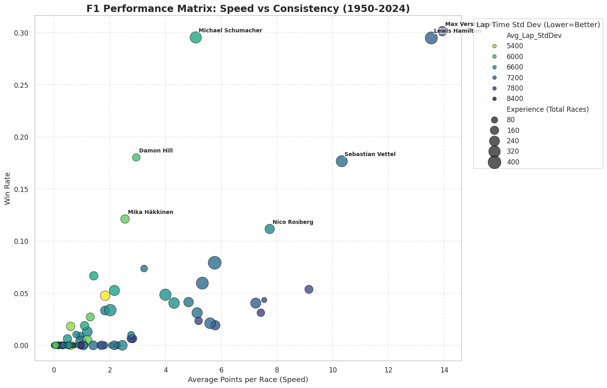
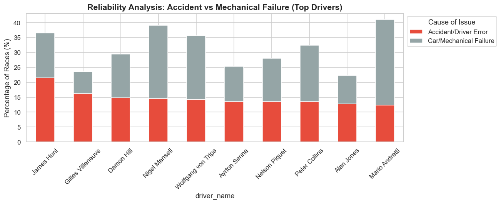
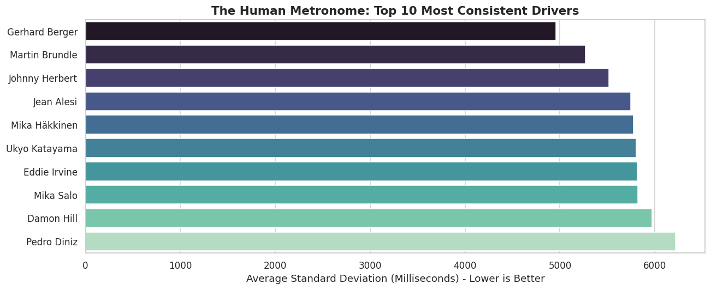
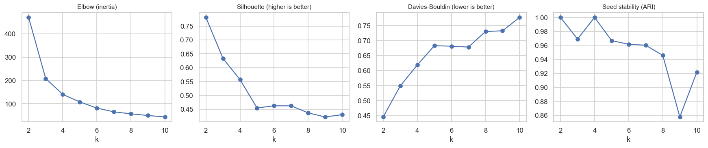
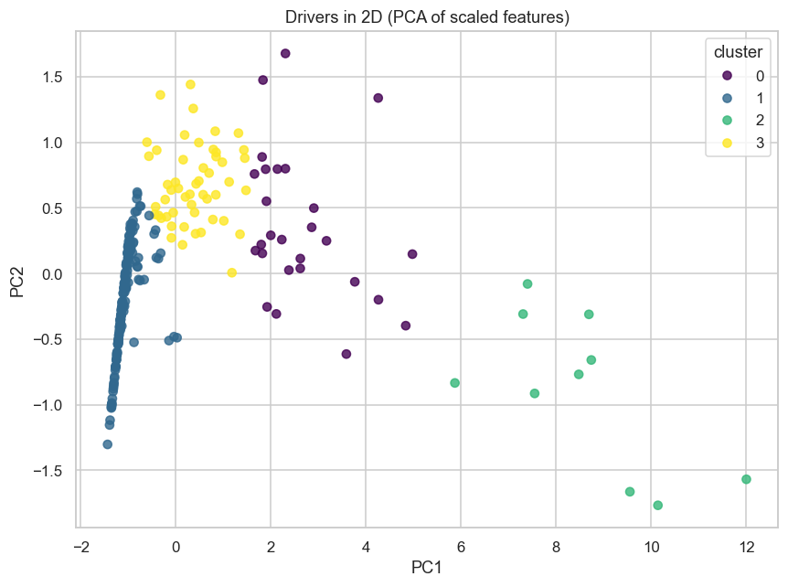
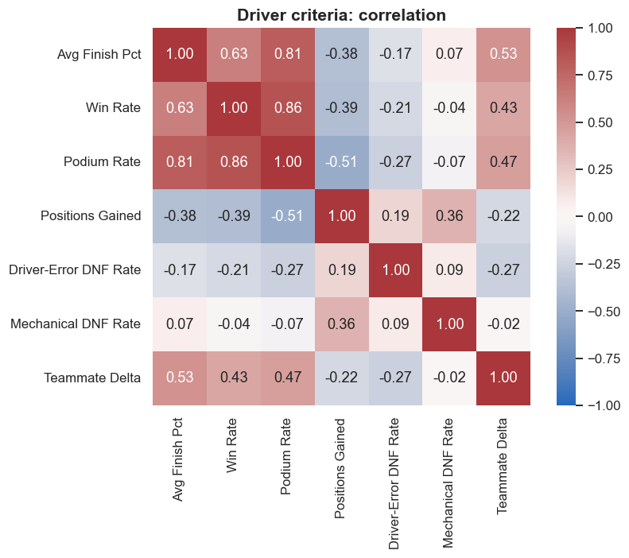
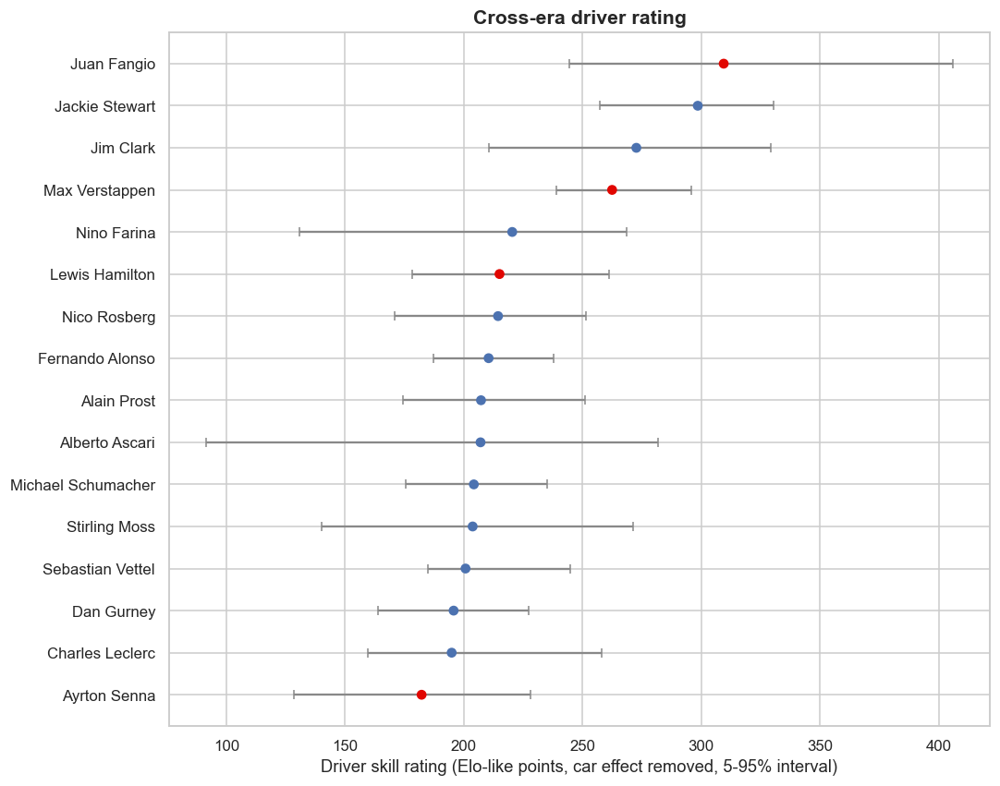

# 🏎️ F1 Advanced Analytics: Speed, Consistency & Reliability (1950-2024)

[](https://github.com/reginaldooo)
[](https://linkedin.com/in/farrel-reginaldo)
[](https://www.kaggle.com/datasets/rohanrao/formula-1-world-championship-1950-2020)
[](https://python.org)
[](https://f1-advanced-analytics.streamlit.app/)
[](https://github.com/reginaldooo/F1-advanced-analytics/actions/workflows/ci.yml)

> **"How do you compare F1 drivers across eras without letting points systems and cars decide?"**

## 📖 Project Background & Motivation
Formula 1 is one of the most data rich sports in the world. However, historic analysis often suffers from **Recency Bias** (favoring current drivers) or **Nostalgia Bias** (favoring legends without context). Furthermore, looking solely at "Championship Titles" ignores the nuance of car reliability and consistency.

**The Problem:** How do we objectively compare drivers across different eras (e.g., Fangio vs. Verstappen) while accounting for car failures and driving styles?

**The Solution:** This project utilizes an advanced data driven approach:
1.  **Unsupervised Learning (K-Means)** to segment drivers based on performance metrics, not opinions.
2.  **Telemetry Analysis** (Lap Times) to measure driver consistency ("The Human Metronome").
3.  **Status classification**: a hand-labelled table of all 139 race statuses (with a trained TF-IDF fallback for unseen ones) separates "Bad Luck" (Mechanical Failure) from "Driver Error" (Crashes).

---

## 📊 Key Insights & Conclusions

After analyzing over 70+ years of race data, here are the key findings:

### 1. Speed $\neq$ Consistency
Consistency is measured as the standard deviation of each lap time relative to that race's median pace (laps above 107% of the median are dropped), so circuits are comparable.
* The most consistent drivers with 50+ races are **Jos Verstappen, Christian Klien, Alexander Wurz, Johnny Herbert** and **Mika Salo** (Gerhard Berger is 7th). Almost all are midfielders or backmarkers.
* **Mika Häkkinen** (93rd of 107), **Martin Brundle** (92nd) and **Michael Schumacher** (94th) rank near the bottom, the opposite of the earlier version of this analysis.
* **Hamilton** (rank 80 of 107) and **Max Verstappen** (rank 63 of 107) sit in the lower half on consistency but top the era-neutral performance ranking.
* **Insight:** A driver can be extremely consistent without being fast. Caveat: lap-time variance is also shaped by the car and the field (a midfield car running in traffic near the median has low variance), so low variance is not pure driver skill.
* *Lap time data only exists from 1996, so this metric covers 107 drivers, not the full history.*

### 2. The "Legend" Tier is Exclusive
Using K-Means Clustering on *Average Finish Percentile*, *Podium Rate* and *Win Rate* (all era-neutral, scaled with `RobustScaler`), only 10 of 246 drivers fall into the **"Dominant Legends"** category: Fangio, Ascari, Moss, Clark, Stewart, Prost, Senna, Schumacher, Hamilton and Verstappen.
* **Why k=4:** silhouette and Davies-Bouldin favour k=2 (backmarkers vs everyone else), which is too coarse. k=4 is the finest split with silhouette above 0.5 (0.54) and near-perfect seed stability (ARI = 0.98); at k=5 silhouette drops to 0.43 and stability to 0.56. GMM scores lower, and HDBSCAN leaves 66 of 246 drivers (27%) unassigned, so the tiers are a segmentation of a continuum, not natural groups.
* Raw points were dropped because the scoring system changed many times (a win was worth 8 points in 1950 and 25 today), which skewed the earlier clusters.* **Sensitivity check:** rescoring every race with one modern points scale gives points per race that rank drivers almost the same way (Spearman 0.94 vs finish percentile, 0.93 vs podium rate, 0.84 vs win rate). The tier edges are less stable. Clustering on rescored points alone gives an adjusted Rand index of 0.62 against the published tiers. Nine of the ten Dominant Legends stay, Moss drops out, and Farina, Gonzalez, Hawthorn and Vettel move in.
* The model also groups drivers who never won a championship as **"Podium Contenders."** The tiers describe the data. They do not prove skill.

### 3. Reliability Analysis: Bad Luck vs. Aggression
By classifying DNF (Did Not Finish) reasons, we tested historical reputations:
* **James Hunt:** Confirmed. Among top-tier drivers he has the highest share of races ending in **Accidents/Collisions** (21.5%).
* **Nigel Mansell:** *Not* confirmed as an outlier. About a third of his races (33%) ended in mechanical failure, but Peter Collins, Mario Andretti and others are higher. Mechanical attrition mostly tracks the era: older cars broke more, whoever drove them.
* *Correction:* the earlier keyword rules missed statuses such as Transmission, Turbo and Fuel system, which understated mechanical failures (Mansell 24.5% before, 32.8% now).

### 4. The Consistency Paradox
Interestingly, the drivers with the absolute highest statistical consistency (lowest pace variance) are rarely World Champions.
What the data shows is that none of the 20 most consistent drivers are champions. The explanations below are hypotheses, not findings, because the data has no mechanism behind them.
* **Possible "Safe Zone" effect:** Extreme consistency may reflect driving within a comfort zone, while title contenders push closer to the limit, which adds lap-time variance.
* **Possible strategic variation:** Elite drivers may alter pace on purpose to manage tyres or fuel, which would lower their "consistency score" without hurting results.

### 5. Which Criteria Actually Add Information?
Beyond finish percentile and win/podium rate, each driver now has racecraft (positions gained), reliability (driver-error and mechanical DNF rates) and a teammate-relative score (finish percentile minus the other driver in the same car, 20+ shared races).
* **Redundancy:** win rate, podium rate and finish percentile correlate at r = 0.66 to 0.86, and the first principal component explains 66% of the variance. They measure mostly the same thing.
* **Positions gained** correlates *negatively* with podium rate (r = -0.50): front-runners start near the front and have little to gain, so it reflects grid position as much as racecraft. It also correlates with mechanical DNF rate (r = 0.56): in unreliable eras many cars retire, so finishers gain places.
* **Mechanical DNF rate** is nearly independent of performance (|r| <= 0.11), a clean "car luck" axis.
* **Teammate delta** adds car-adjusted information (r = 0.43 to 0.52 with results). Top of 237 drivers: Jim Clark, Juan Fangio, Christian Fittipaldi, Emerson Fittipaldi, Pedro Rodriguez; Max Verstappen is 8th.
* *Caveat: in a dominant car both teammates finish near the top, which compresses the delta (Hamilton ranks 49th of 237). A low delta is not proof of a weaker driver.*

### 6. Fangio vs Verstappen: A Cross-Era Rating
A Bradley-Terry model on race finishing order (151k pairwise comparisons) estimates each driver's skill with a separate effect for every constructor-season, so teammates and team changes separate driver from car. Mechanical retirements are not counted as losses.
* **The driver term matters:** held-out log-loss (race-grouped folds) is 0.545 for driver + car vs 0.559 for car only and 0.693 for a coin flip; pairwise accuracy 72.6% vs 70.9%.
* **Robust top tier:** Fangio, Stewart and Clark stay in the top 3 for every regularisation strength tested, and Max Verstappen stays in the top 6 (4th at the cross-validated setting, rating 262 vs Fangio's 309, intervals overlap).
* **Not separable from the car:** Hamilton ranges from 3rd to 28th, Schumacher from 5th to 31st and Senna from 11th to 50th depending on regularisation. Beyond the top 4 the bootstrap intervals overlap heavily, so read the ranking as tiers.
* *Caveats: skill is constant over a career, and eras are linked only through drivers whose careers overlap, so 1950s intervals are wide.*

---

## 📈 Visualizations
*(Note: These images are generated by the notebook)*

| Performance Matrix | Reliability Analysis | Human Metronome |
| :---: | :---: | :---: |
|  |  |  |

| Choosing k | Clusters in 2D (PCA) | Criteria correlation |
| :---: | :---: | :---: |
|  |  |  |

| Cross-era rating |
| :---: |
|  |

---

## 🛠️ Tech Stack & Methodology

* **Data Cleaning:** Handling 70 years of inconsistent data (e.g., treating `\N` values, normalizing constructor names).
* **Feature Engineering:**
    * *Average Finish Percentile*, *Podium Rate* & *Win Rate* for clustering (era-neutral, no raw points).
    * *Rescored PPR*: every race rescored with one modern points scale, used only as a sensitivity check, not for clustering.
    * *Standard Deviation* of lap pace relative to the race median (~589k lap records, laps > 107% of median removed).
    * *Status classification*: 139 hand-labelled statuses (`src/f1/status_labels.csv`) plus a TF-IDF + logistic regression fallback for unseen statuses (leave-one-out accuracy 91% vs 32% for the old keyword rules).
* **Machine Learning:** K-Means Clustering (`sklearn`, `RobustScaler`, k=4) to create driver personas.
* **Visualization:** Seaborn & Matplotlib for high dimensional data representation.

---

## 🚀 How to Run Locally

1.  **Clone and install**
    ```bash
    git clone https://github.com/reginaldooo/F1-advanced-analytics.git
    cd F1-advanced-analytics
    pip install -e ".[dev]"
    ```
2.  **Data**
    * Nothing to download by hand: `f1.data.load_tables()` reads `./data`, then `$F1_DATA_DIR`, then downloads the [Kaggle dataset](https://www.kaggle.com/datasets/rohanrao/formula-1-world-championship-1950-2020) with `kagglehub`.
    * *(Data is not included in this repo.)*
3.  **Run**
    ```bash
    jupyter lab f1-advanced-analytics.ipynb   # explore
    make figures                              # re-run the notebook and regenerate images/
    make test                                 # pytest + coverage (>= 80%)
    make lint                                 # ruff
    ```

## 🖥️ Streamlit App

**Live app: https://f1-advanced-analytics.streamlit.app/**

An interactive app (Driver Explorer, Cluster View, Compare two drivers, Methodology) reads a small precomputed table, `app/data/drivers.csv`, so it needs no Kaggle access.

```bash
make app-data   # rebuild app/data/drivers.csv from the Kaggle data (about 5 seconds)
make app        # streamlit run app/streamlit_app.py
```

Deploying on Streamlit Community Cloud is described in [`docs/DEPLOY.md`](docs/DEPLOY.md).

## ⚖️ Data & Attribution

Source: [Formula 1 World Championship 1950-2024](https://www.kaggle.com/datasets/rohanrao/formula-1-world-championship-1950-2020) by Vopani on Kaggle (listed as CC0; the underlying Ergast data is CC BY-NC-SA 3.0). Raw data is not redistributed here; the committed `app/data/drivers.csv` holds derived driver-level statistics only. Credit is given and the project is non-commercial.

## 🗂️ Project Structure

```
app/           Streamlit app and its precomputed table
src/f1/        data loading, features, clustering + model selection, criteria profile, DNF classifier, cross-era rating, charts
tests/         pytest suite (synthetic fixtures, no downloads)
docs/          METHODOLOGY.md (data, features, limitations)
baseline/      frozen v1 notebook and README (tag v1-baseline)
f1-advanced-analytics.ipynb   storytelling notebook, imports from src/f1
```

See [`docs/METHODOLOGY.md`](docs/METHODOLOGY.md) for features and limitations and [`ROADMAP.md`](ROADMAP.md) for what is next.

---

*Project by Reginaldo Ahnaf*